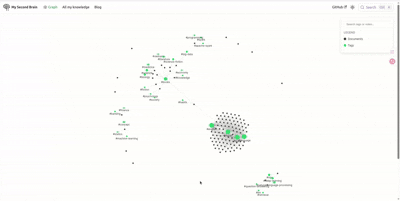

# docusaurus-plugin-graph-view

[](https://www.npmjs.com/package/docusaurus-plugin-graph-view)
[](https://github.com/whoisltd/docusaurus-plugin-graph-view/blob/main/LICENSE)

> An interactive, knowledge graph for your [Docusaurus](https://docusaurus.io/) site.

<p align="center">
  
</p>

## Features

- **Force-Directed Graph** — Powered by [d3-force](https://github.com/d3/d3-force) and rendered on a 2D Canvas for smooth performance.
- **Dynamic Pan & Zoom** — Viewport smoothly glides and focuses on selected nodes.
- **Connection Filters** — Real-time filter controls to toggle Tag Links (solid) vs. Doc Links (dashed).
- **Tag-Based Clustering** — Frontmatter `tags` automatically group related documents.
- **Theme Variables** — Respects Docusaurus theme colors naturally (customizable via CSS variables).
- **Mobile Responsive Drawer** — Swaps to a vertical bottom-drawer overlay on viewports `< 768px`.
- **Inline-Link Detection** — Automatically detects `[links](./path.md)` and Obsidian-style `[[wikilinks]]`.

## Installation

```bash
npm install docusaurus-plugin-graph-view
```

**Peer dependency:** `@docusaurus/core >= 3.0.0`

## Usage

Add the plugin to your `docusaurus.config.js`:

```javascript
module.exports = {
  plugins: [
    [
      'docusaurus-plugin-graph-view',
      {
        paths: ['docs'],          // Directories to scan for .md/.mdx files
        routePath: '/graph',      // Route where the graph page will be accessible
        title: 'Knowledge Graph', // Page title
        linkDetection: true,      // Detect inline [links](./path.md) between docs
        wikilinks: false,         // Detect [[wikilinks]] (for Obsidian users)
      },
    ],
  ],
};
```

### Document Connections (How to Link Docs)

The plugin connects nodes in your graph in three ways:

1. **Frontmatter Tags**: Group documents visually under tag hub nodes.
   ```markdown
   ---
   tags: [machine-learning, neural-networks]
   ---
   ```
2. **Markdown Links**: Create doc-to-doc connections (dashed blue lines).
   ```markdown
   Refer to the [Activation Functions](./activation-functions.md) page.
   ```
3. **Obsidian-Style Wikilinks** (Requires `wikilinks: true`):
   ```markdown
   Refer to the [[activation-functions|Activation Functions]] page.
   ```

#### Optional: Compile [[wikilinks]] inside Docusaurus Pages
To resolve `[[wikilinks]]` into clickable links on your compiled Docusaurus pages, wire up our companion Remark plugin:

```javascript
const path = require('path');
const wikilinkPlugin = require('docusaurus-plugin-graph-view/remark/wikilinkPlugin');

module.exports = {
  presets: [
    [
      'classic',
      {
        docs: {
          remarkPlugins: [
            [wikilinkPlugin, { siteDir: __dirname, paths: ['docs'] }],
          ],
        },
      },
    ],
  ],
};
```

## Styling Customization

Exposed CSS variables can be added to your `/src/css/custom.css` file:
```css
:root {
  --graph-color-highlight: #a855f7;
  --graph-color-node-tag: #2ecc71;
  --graph-color-node-doc-light: #444444;
  --graph-color-node-doc-dark: #888888;
}
```

## Contributing

Contributions, issues, and feature requests are welcome!  
Feel free to check the [issues page](https://github.com/whoisltd/docusaurus-plugin-graph-view/issues).

## License

MIT © [whoisltd](https://github.com/whoisltd)
